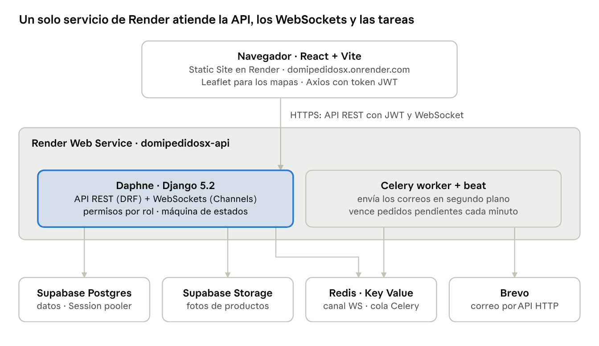

# Arquitectura del sistema

DomiPedidosX es una aplicación web de una sola página (React) que habla con una API en Django.
La API atiende tanto las peticiones normales como las conexiones en tiempo real por WebSocket.

| Pieza | Tecnología | Qué hace |
|---|---|---|
| Frontend | React 19 + Vite + Tailwind, en un Static Site de Render | Interfaz de los 5 roles. Leaflet para los mapas, Axios con token JWT |
| API y tiempo real | Django 5.2 + DRF + Channels, servido por Daphne en un Web Service de Render | API REST, WebSockets, permisos por rol y máquina de estados del pedido |
| Tareas en segundo plano | Celery worker + beat, en el mismo servicio de Render | Envía los correos y vence cada minuto los pedidos pendientes |
| Base de datos | PostgreSQL en Supabase (Session pooler) | Todos los datos del sistema |
| Archivos | Supabase Storage (compatible con S3) | Fotos de los productos |
| Mensajería | Redis (Render Key Value) | Canal de los WebSockets entre procesos y cola de Celery |
| Correo | Brevo, por API HTTP | Confirmaciones, cambios de estado, asignaciones y alertas |

## Cómo fluye una petición

1. El navegador pide datos a la API por HTTPS, con un token JWT.
2. Los cambios de estado de un pedido llegan al instante por WebSocket (Django Channels); Redis reparte esos mensajes entre procesos.
3. Lo lento o programado (correos, vencer pedidos) lo hace Celery en segundo plano, usando Redis como cola.
4. Los datos se guardan en PostgreSQL y las fotos en Supabase Storage.

## Organización del backend

El backend está dividido por dominios, cada uno una app de Django: `usuarios`, `sedes`, `menu`,
`inventario`, `promociones` y `pedidos`. Sus dependencias y modelos están en [README.md](README.md).

Los detalles de cada servicio en la nube y por qué se eligió están en [despliegue.md](despliegue.md).
